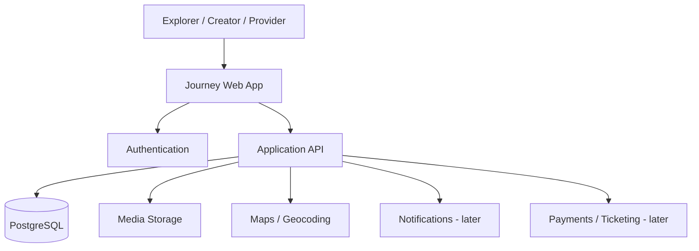

# Journey
### Discover experiences. Trust real stories. Book what inspires you.

> Journey is a proposed experience-discovery platform that connects social discovery with local events, places, and service providers.

**Project status:** Concept / early planning  
**Repository purpose:** Product documentation and starter blueprint. The application itself has not been implemented yet.

---

## The problem

People often discover experiences on social media, look for event details on separate platforms, search independently for providers, and then have to work out whether the information is genuine. Discovery, trust, and booking are fragmented across multiple services.

## The idea

Journey aims to connect that flow in one place:

**Experience → Share → Discover → Trust → Book**

Users would be able to:
- Share photos and short videos from real experiences.
- Discover events, destinations, venues, and activities.
- Explore the businesses or service providers behind an experience.
- Find practical details such as location, packages, and indicative costs.
- Save experiences and contact providers.
- Distinguish verified information and genuine user experiences from sponsored promotions.

The long-term vision is broader than event ticketing: Journey is intended to help people discover *what to experience*, then take the next step with better context.

## Who it is for

| User group | Primary need |
|---|---|
| Explorers / attendees | Find worthwhile experiences and reliable details |
| Event organisers | Showcase events and reach interested audiences |
| Local businesses / providers | Present services and receive qualified enquiries |
| Creators / contributors | Share useful experiences and build an audience |

## Proposed MVP

The first release should validate discovery and provider enquiry before attempting a large marketplace.

1. **Accounts and profiles** — basic user, organiser, and provider profiles.
2. **Experience feed** — image/video posts with captions, location, category, and tags.
3. **Discovery** — browse and filter experiences by category and location.
4. **Experience detail** — event/place information, provider profile, and enquiry action.
5. **Save / follow** — save posts and follow creators or providers.
6. **Trust signals** — clear verification status and transparent sponsored labels.

**Not in the first MVP:** complex ticketing, escrow, dynamic pricing, recommendation AI, or a multi-vendor payment system. These should follow only after the core discovery loop is tested.

## Product principles

- **Real context over vanity metrics:** useful details matter more than likes.
- **Trust is explicit:** verification and sponsorship must be clearly labelled.
- **Discovery before transaction:** help users understand an experience before asking them to book.
- **Provider attribution:** make it clear who is offering a service.
- **Build in stages:** validate the smallest useful workflow before adding complexity.

## Proposed technology (not yet implemented)

| Layer | Suggested choice | Purpose |
|---|---|---|
| Web application | Next.js + TypeScript | Responsive frontend and application routes |
| UI | Tailwind CSS | Consistent interface styling |
| Backend / API | Next.js route handlers initially | MVP business logic |
| Database | PostgreSQL (e.g. Supabase) | Users, posts, places, events, providers, saves |
| Authentication | Supabase Auth | Sign-in and role-aware sessions |
| Media | Supabase Storage or compatible object storage | User-uploaded photos and videos |
| Maps | Map provider integration | Location discovery |
| Deployment | Vercel + managed database | Initial hosting |

These are recommendations, not claims about an existing codebase. The stack can change after technical validation.

## High-level architecture



## Core domain model (initial)

- **User** — account identity and profile.
- **Provider** — business or service-provider profile, owned by a user or organisation.
- **Experience** — a discoverable event, place, activity, or curated experience.
- **Post** — user-generated media and story linked to an experience and/or provider.
- **MediaAsset** — stored image or video metadata.
- **Follow** — relationship between a user and a creator/provider.
- **SavedItem** — an experience or post saved by a user.
- **Enquiry** — an expression of interest sent to a provider.
- **VerificationRecord** — evidence and review state for a provider or listing.
- **Promotion** — paid placement, always visibly labelled as sponsored.

## Suggested repository structure

```text
journey/
├── app/                    # Next.js routes and pages (when implementation begins)
├── components/             # Shared UI components
├── features/               # Feed, discovery, profiles, provider enquiries
├── lib/                    # Database, auth, validation, utilities
├── public/                 # Static assets
├── docs/
│   ├── PRODUCT_BRIEF.md
│   ├── ARCHITECTURE.md
│   └── ROADMAP.md
├── .github/ISSUE_TEMPLATE/
├── .gitignore
├── CONTRIBUTING.md
└── README.md
```

## Roadmap

See [docs/ROADMAP.md](docs/ROADMAP.md) for phased milestones.

## Current status and honesty note

This repository currently documents the product concept, proposed MVP, architecture, and development plan. It does **not** yet contain a working application, deployed demo, real users, verified providers, or live booking functionality. Implementation progress should be reflected here as it happens.

## Getting involved

See [CONTRIBUTING.md](CONTRIBUTING.md) for the proposed development workflow. Early feedback is especially useful on the discovery experience, trust model, and MVP scope.

## Author

**Project creator:** Yash Singh  
**Project:** Journey — Experience Discovery Platform

---

*Built from an independent product idea: making it easier to discover experiences, understand who provides them, and take the next step with confidence.*
